# Sísifo v1.12.0 — Ruínas

> **Status:** implementada no branch `feat/ruinas`, ainda sem commit · **Base:** v1.11.0 · **Data do design:** 30/10/2026
> Design: [`docs/superpowers/specs/2026-10-30-ruinas-design.md`](../superpowers/specs/2026-10-30-ruinas-design.md) · Plano: [`docs/superpowers/plans/2026-10-30-ruinas.md`](../superpowers/plans/2026-10-30-ruinas.md) · Protótipo: [`prototipo.html`](../superpowers/specs/2026-10-30-ruinas/prototipo.html)

## Resumo

O Sísifo ganha um cenário. No mito, Sísifo empurra a pedra morro acima para sempre. Nesta versão, o morro fica entre **ruínas gregas desenhadas em pontilhado**, e o topo que ele nunca conquista de vez é um templo em ruínas. Nenhum dado, regra ou funcionalidade muda: a atualização é só visual.

## O que muda para quem usa

| Onde | Antes | Depois |
|---|---|---|
| **Tela Hoje** | Cartão com a encosta em linha e uma bandeira no topo | A encosta vira paisagem pontilhada, com o templo em ruínas no topo. A pedra azul sobe conforme você conclui tarefas, hábitos e treino. |
| **Finanças, Tarefas e demais telas** | Fundo liso | Colunas grandes e bem apagadas ao fundo, como marca d'água. Números e listas continuam com o mesmo destaque. |
| **Login** | Formulário centralizado | No computador, formulário à esquerda e ruínas à direita. No celular, colunas atrás do formulário. |
| **Modo Painel** | Encosta com bandeira | Encosta do Pomodoro com o templo no topo e ruínas ao fundo, mais apagadas atrás do relógio. |
| **Logo** | Pedra e encosta dentro de um quadrado azul | Só a linha da encosta e a pedra azul, sem o quadrado. |
| **Ícone do app e abertura no iPhone** | Fundo azul | Fundo quase preto, traço claro e pedra azul. A tela de abertura acompanha o tema do aparelho. |
| **Cores de fundo** | Escuro `#0f1311` · Claro `#eceee9` | Escuro `#0d0f0e` (quase preto) · Claro `#ebe7df` (mármore) |

A cor de destaque (azul), a tipografia e a navegação **não mudam**.

> **Depois de atualizar no iPhone:** o ícone e a tela de abertura só mudam quando o app é removido e adicionado de novo à Tela de Início, porque o iOS guarda os antigos.

## Telas do protótipo

### Hoje: a encosta entre ruínas

| Escuro | Claro |
|---|---|
| 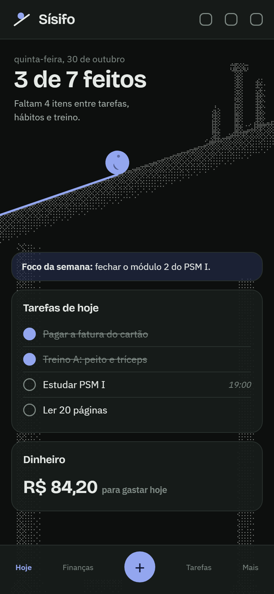 | 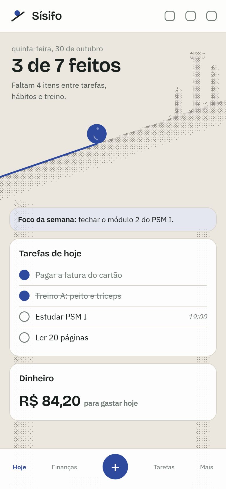 |

### Finanças: colunas apagadas ao fundo

| Escuro | Claro |
|---|---|
| 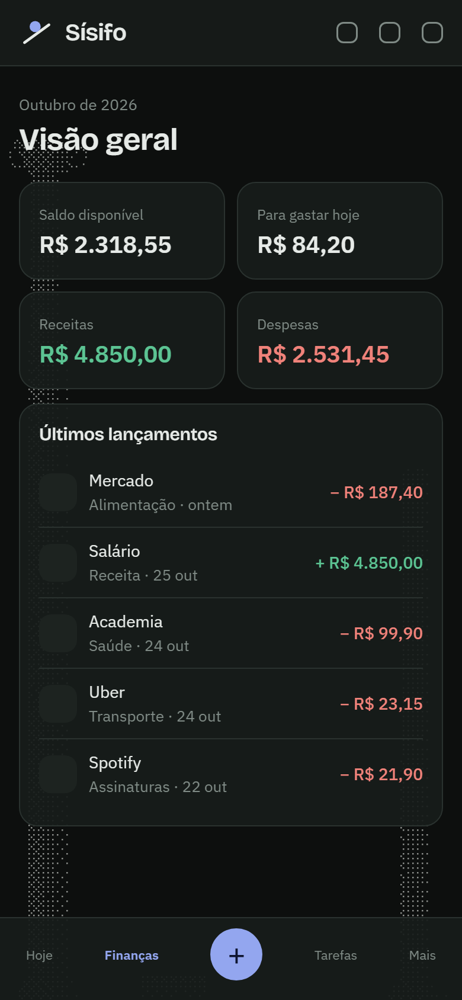 | 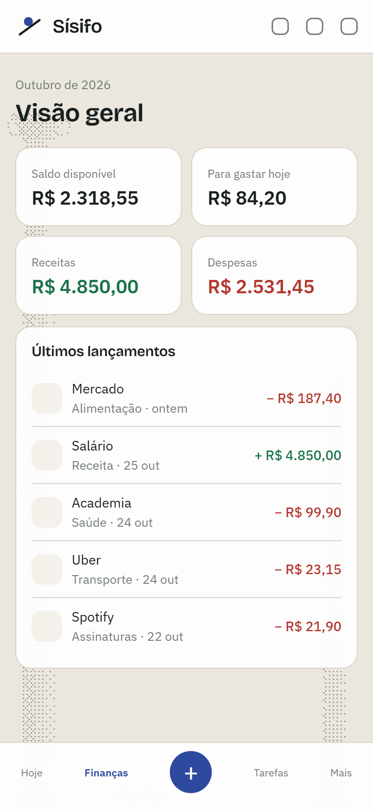 |

### Login

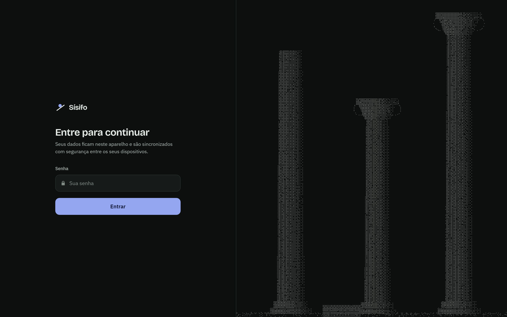
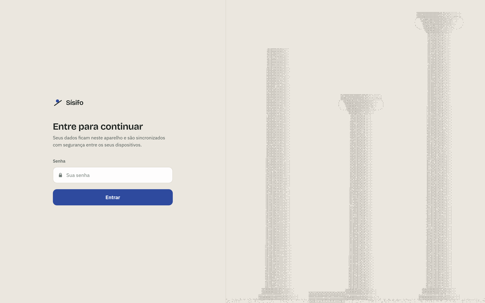

| Celular, escuro | Celular, claro |
|---|---|
| 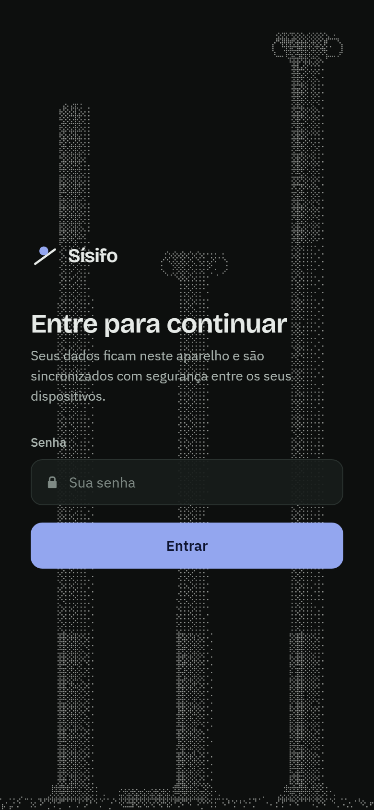 | 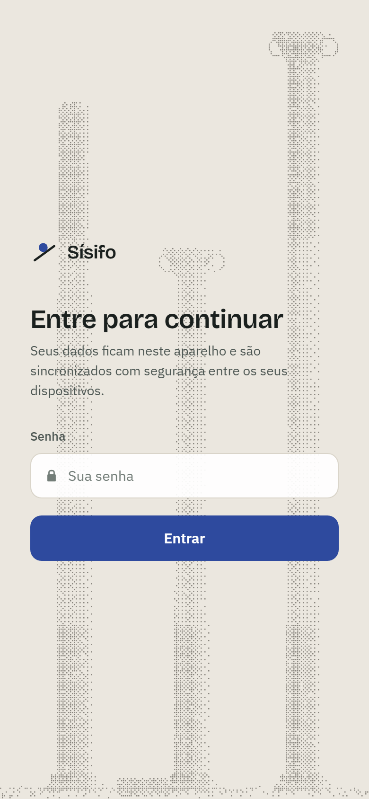 |

### Modo Painel (Pomodoro)

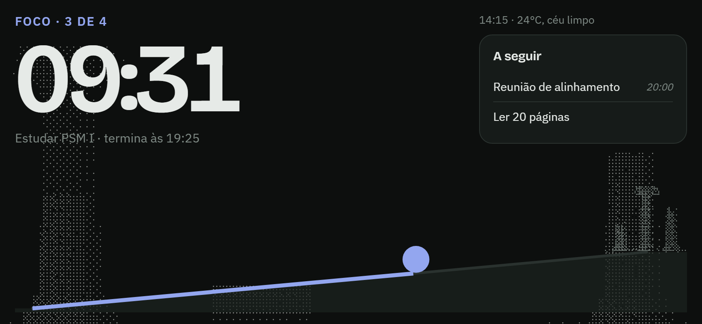
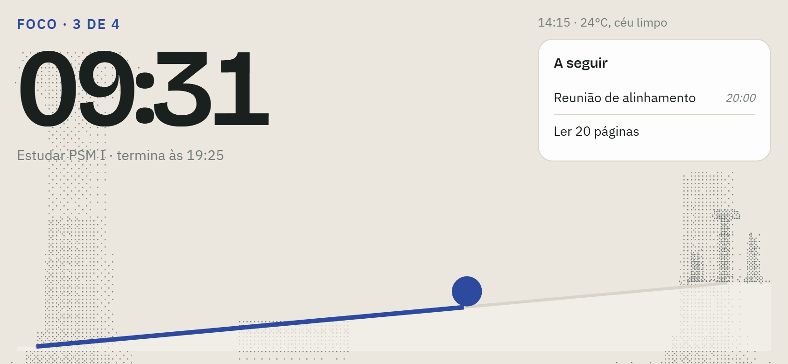

### Logo, ícone e favicon

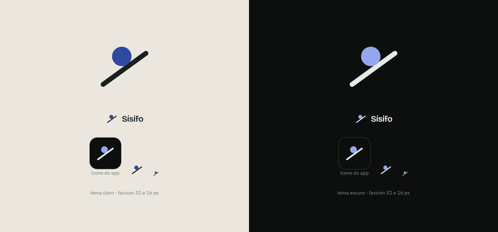

> As imagens vêm do protótipo estático. Na implementação, a composição exata das colunas pode variar um pouco.

## Como funciona (visão técnica)

- **As ruínas são desenhadas por código, não são imagens.** Um motor puro em `src/lib/ruins/` monta uma grade de luminância com as formas (base, fuste com caneluras, capitel jônico com volutas, topos quebrados, tambores caídos e erosão) e transforma cada célula em ponto ou vazio com a matriz Bayer 4×4, a mesma técnica do efeito *dither* da referência.
- **Determinístico:** cada cena usa uma semente fixa, então as ruínas ficam sempre no mesmo lugar.
- **Três cenas:** `backdrop` (fundo apagado, com no máximo 35% de intensidade), `summit` (encosta + templo da tela Hoje) e `login`.
- **Duas saídas:**
  - `<Ruins kind="…">` em `<canvas>`: desenha uma vez e redesenha só ao mudar o tamanho da tela ou o tema.
  - `toDotPath()`: gera um `path` SVG para o templo dentro do `Hill` do painel.
- **Sem custo contínuo:** nada de animação no cenário. A pedra continua sendo o único elemento animado, e com "reduzir movimento" ligado nem ela anima.
- **Cores por tema:** tokens `--ruins` e `--ruins-alpha` em `src/index.css`.
- **Offline:** nada é baixado. Tudo é gerado no aparelho.

## Arquivos novos e alterados

**Novos:**
- `src/lib/ruins/dither.ts` e `src/lib/ruins/scenes.ts`, com testes
- `src/components/ui/Ruins.tsx`
- `src/features/dashboard/summit.ts`, com testes
- `scripts/icons.mjs` (monta os ícones a partir da marca) e `scripts/brand/splash.svg`

**Alterados:**
- Tela e layout: `src/index.css`, `AppLayout.tsx`, `Card.tsx`, `BoulderHero.tsx`, `LoginScreen.tsx`, `Logo.tsx`
- Painel: `Hill.tsx`, `PomodoroTab.tsx`, `PanelApp.tsx`
- Cores do sistema e PWA: `themeStore.ts`, `vite.config.ts`, `index.html`, `scripts/splash.mjs`
- Ícones: `public/favicon.svg` e os PNGs de ícone e splash em `public/`

## Comandos novos

```bash
npm run icons    # gera pwa-192, pwa-512, maskable-512 e apple-touch-icon a partir da marca (scripts/icons.mjs)
npm run splash   # gera as telas de abertura do iPhone a partir de scripts/brand/splash.svg
```

Rode os dois de novo sempre que trocar o logo ou as cores de fundo.

## Regras que esta versão cria

1. **As ruínas ficam paradas.** Nenhum timer ou `requestAnimationFrame` para o cenário.
2. **Legibilidade vem antes do cenário:** onde houver texto importante, as colunas apagam mais (máscara).
3. **O fundo nunca passa de `BACKDROP_DEPTH = 0.35`** e usa uma opacidade própria, menor (`--ruins-backdrop-alpha`).
4. **Ícone instalado na versão escura**, porque o ícone na tela inicial não acompanha o tema. O favicon da aba acompanha.

## Como validar

- `npm run typecheck && npm test && npm run build`
- Percorrer todas as telas nos temas claro e escuro, no celular (375 px) e no computador (1440 px), além do login, de `/painel` (retrato e paisagem) e de `/treino`.
- No painel, deixar 10 s parado com o DevTools → Performance aberto: o canvas não pode redesenhar.
- Instalar no celular e conferir o ícone e a tela de abertura.
